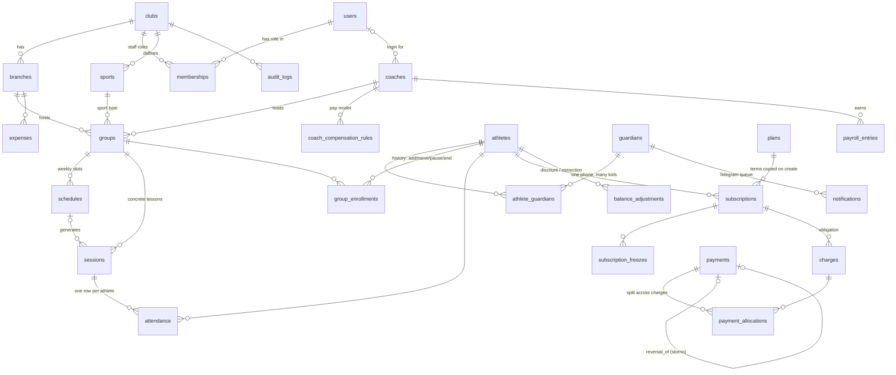

# DB diagram (PRD §3, §17)

Core chains: **club → branch → group → session**, **athlete ↔ guardian**, **subscription → charge → payment**.
Every tenant row carries `club_id`. Money = integer UZS (`bigint`). Timestamps = UTC `timestamptz`; calendar dates = `date`.



## Key constraints

| Rule (PRD) | Enforcement |
|---|---|
| One attendance record per athlete per session (§7, §14) | `UNIQUE (session_id, athlete_id)` |
| Duplicate cash payment on retry (§12, §14) | `UNIQUE (club_id, idempotency_key)` on `payments` |
| A payment can be reversed only once (§6) | `UNIQUE (reversal_of_id)` |
| One guardian per phone per club; many children (§3, §4) | `UNIQUE (club_id, phone)` on `guardians` + link table |
| One open enrollment per athlete per group (§4) | partial `UNIQUE (athlete_id, group_id) WHERE status <> 'ended'` |
| One session per group/date/start time (§7) | `UNIQUE (group_id, session_date, start_time)` |
| Notification dedupe (§10) | `UNIQUE (club_id, dedupe_key)` |
| Required indexes (§3) | `(club_id, branch_id)`, `(club_id, due_date)`, `(group_id, session_date)` |

## Balance

```
balance = Σ charges (not void) − Σ payments (reversals are negative rows) − Σ balance_adjustments
balance > 0 → debt;  balance < 0 → advance
```
